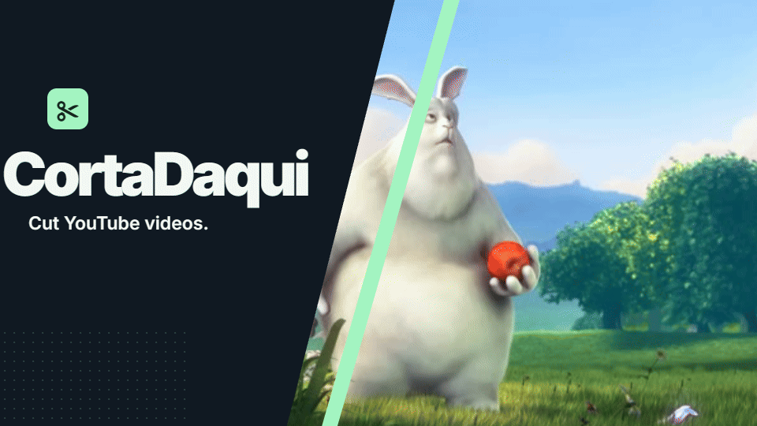

# CortaDaqui



Pick the start and end of a public YouTube video and save that segment as an MP4. CortaDaqui is a native Rust app for Windows x64 with a lightweight Slint interface.

## Build and run

Install Rust for `x86_64-pc-windows-msvc` and the Visual Studio C++ build tools. Run the following commands in PowerShell.

```powershell
cargo build --release --locked
.\target\release\cortadaqui.exe
```

The app targets Windows 10 version 1709 or later and Windows 11. It was tested on Windows 11 x64. The desktop interface is in Brazilian Portuguese.

## Cut a clip

1. Paste a public YouTube link and select **Carregar** (Load). The app shows the title, thumbnail, and duration.
2. Drag the timeline handles or enter **Início** (Start) and **Fim** (End). The fields accept seconds, `MM:SS`, or `HH:MM:SS`, with up to three decimal places. Select at least one frame.
3. Set **Destino do MP4** (MP4 destination) and select **Exportar MP4**. You can cancel during export. If a filename is already taken, the app saves under a new name.

CortaDaqui tries to download just your selection first. If the full video is needed, it uses a temporary folder in the export destination and clears that folder when the job ends. It re-encodes the selected frames as H.264, adds AAC when the source has audio, and exports up to 1080p.

## Tools and clipboard

On first launch, CortaDaqui downloads yt-dlp, FFmpeg, and Deno to `%LOCALAPPDATA%\CortaDaqui\tools` and verifies each download with SHA-256. In **Ferramentas** (Tools), you can check and update yt-dlp and FFmpeg independently. Deno is maintained alongside yt-dlp. Use **Tentar novamente** (Retry) if setup fails.

Enable **Detectar links copiados do YouTube** (Detect copied YouTube links) in **Ferramentas** to load copied links for the current session. A timestamp such as `t=95` sets the start to `00:01:35` when it falls within the video.

Use CortaDaqui for videos you have permission to download and cut. Downloading may be restricted by the [YouTube Terms of Service](https://www.youtube.com/t/terms).

## Tests

```powershell
cargo test --locked
```

To test a cut between keyframes, set `CORTADAQUI_TEST_FFMPEG` to the folder containing `ffmpeg.exe` and `ffprobe.exe`.

```powershell
cargo test --locked ffmpeg_starts_after_a_non_keyframe_cut_and_keeps_audio -- --ignored
```

To check preview loading, export, and cancellation with a public sample, set `CORTADAQUI_TEST_TOOLS` to `%LOCALAPPDATA%\CortaDaqui\tools` after first launch.

```powershell
cargo test --locked exports_a_public_youtube_clip_and_can_cancel -- --ignored
```

## Demo credits

Demo footage excerpted from *Big Buck Bunny*. © 2008 Blender Foundation / www.bigbuckbunny.org. [CC BY 3.0 and attribution](https://peach.blender.org/about/)
